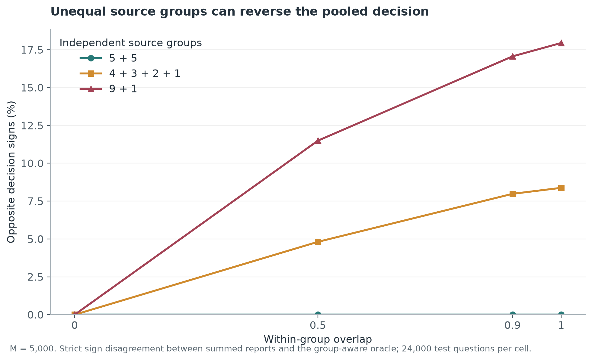
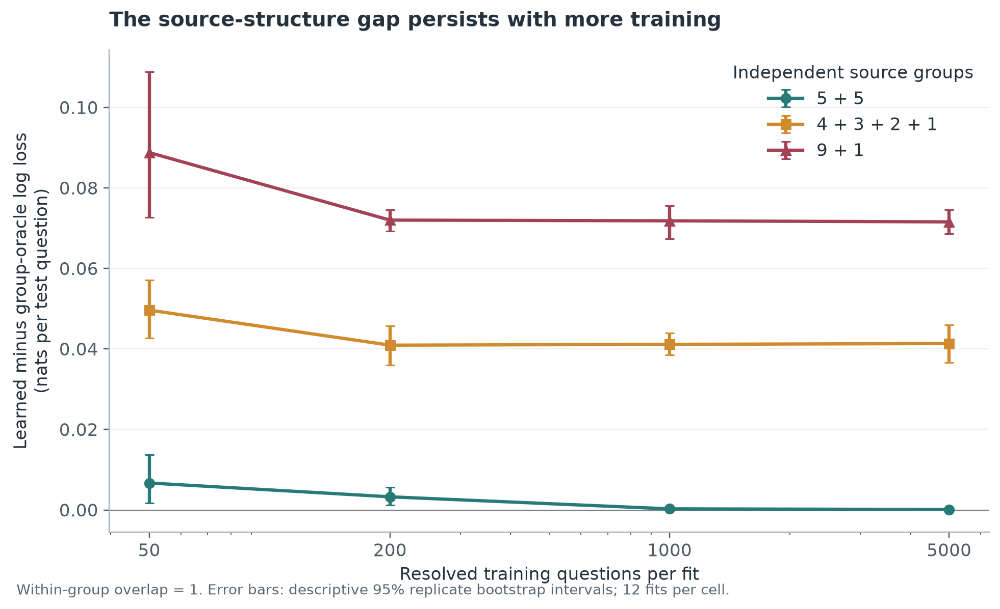
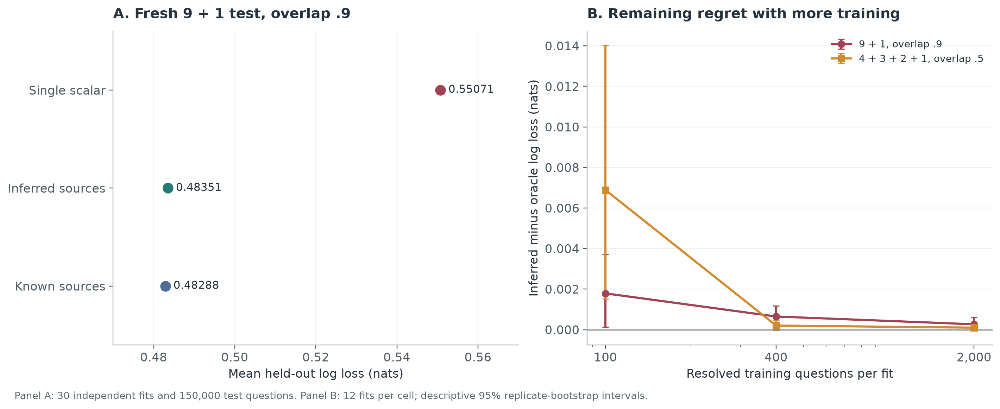

# How many independent forecasts are in a crowd?

Ten people agree that something is likely to happen. How much evidence is that?

It depends on what they know. Ten forecasts can reflect ten independent
observations, or ten versions of the same observation. Even if every forecaster
is individually calibrated, their agreement does not tell us which situation
we are in.

I built a small synthetic experiment around that distinction. The question was
whether a single learned discount could correct for shared evidence, where
that correction would stop working, and whether resolved forecasts could reveal
enough of the missing structure to repair it.

The work happened in three stages: an original frozen experiment, an exploratory
stress sweep prompted by its result, and a fresh frozen experiment on learning
source groups. Keeping those stages separate matters. A failure found while
exploring can motivate a new test, but it cannot turn into a prediction made
before the exploration.

## Counting shared evidence

Start with a binary outcome and a 50% prior. Each forecaster sees a signal:

\[
S_i=a(2Y-1)+\sqrt{\rho}\,U+\sqrt{1-\rho}\,E_i.
\]

The shared noise \(U\) and private noises \(E_i\) are independent standard
normals. Signal strength is \(a\); conditional overlap is \(\rho\). Each
forecaster reports the correct posterior for their own signal, with log odds
\(\ell_i=2aS_i\). The construction makes individual forecasts calibrated by
design. It also lets us calculate the exact joint posterior:

\[
L^*=\frac{\sum_i\ell_i}{1+(n-1)\rho}.
\]

With independent evidence, the log odds add. With perfectly shared evidence,
the same observation counts once. Between those extremes, the denominator
measures how much the simple sum overcounts.

For ten forecasters with overlap .5, the effective signal count is
\(10/5.5\), about 1.82. That is an information equivalence inside this model.
It is not a claim that a real group contains 1.82 independent people. Raw
forecast agreement also mixes shared noise with shared information about the
outcome, so it cannot simply be substituted for \(\rho\).

## Learning the discount

The next step is to hide the overlap and learn a multiplier from resolved
questions. The learner predicts \(\operatorname{logistic}(\hat\beta\sum_i
\ell_i)\), fitting \(\hat\beta\) between zero and one on training log loss.
It receives forecasts and outcomes, with no source labels or true overlap.

The frozen primary experiment used ten forecasters, overlap .5 and signal
strength .5. Each of 30 independent repetitions used 200 training questions
and 10,000 fresh test questions. Lower log loss is better:

| Method | Mean test log loss |
| --- | ---: |
| Arithmetic mean of probabilities | 0.54316 |
| Pool assuming independent evidence | 1.17889 |
| Learned discount | 0.51029 |
| Exact posterior with known overlap | 0.50739 |

The learned pool improved on the arithmetic mean by 0.03287 nats per question
and on the independence pool by 0.66860. The prespecified paired 97.5%
bootstrap intervals for learned minus comparator were [-0.03452, -0.03085]
and [-0.67694, -0.66031]. The bootstrap resampled whole repetitions, so the
uncertainty includes fitting on a fresh training set. These are approximate
intervals, adjusted for the two primary comparisons, rather than exact
finite-sample guarantees. The [primary analysis](../reports/production-primary-v1-analysis.json)
contains the scores and intervals; the [frozen manifest](../configs/production-primary-v1.manifest.json)
records the design.

That is a useful result in a deliberately simple world. The more interesting
question is what happens when the sharing is uneven.

## When the crowd points the wrong way

Suppose nine reports come from one source and the tenth comes from an
independent source. In the fully duplicated limit, imagine the nine reports
say .6 while the independent report says .1. Multiplying all ten odds gives
about .81. Counting each source once gives \(1/7\), about .14.

A positive multiplier can reduce the confidence of that .81 prediction. It
cannot move it below .5. A zero multiplier can only return .5. The problem is
already present in the direction of the summed evidence.

After completing the primary experiment, I specified an exploratory stress
grid covering 192 combinations of overlap, signal strength, ensemble size,
training size and source partition. It includes 1,728 training fits and
2,304,000 held-out question rows. The primary evaluation and this later sweep
have different evidential roles: the sweep maps sensitivity after the original
result was known.

The nine-plus-one case exposes the limitation. At within-source overlap .9,
with 5,000 training questions per fit, the learned pool's mean log loss was
0.55187. The source-aware oracle achieved 0.48230. The gap was 0.06958 nats,
with a descriptive 95% interval of [0.06634, 0.07291]. The learner still beat
the arithmetic mean, whose loss was 0.56009, but considerable information
remained unused. These values come from the `groups-9-1-rho0.9` cell of the
[stress report](../reports/stress-suite-v1.json).

Across that cell's 24,000 test questions, the summed logits and source-aware
oracle pointed to opposite sides of .5 on 4,095 questions, or 17.06%. The
[sign diagnostic](../reports/stress-v1/stress-groups-m5000-v1-signs.json)
records those counts. No amount of training can make a nonnegative scalar
reverse the sign of the same summed input. The structural failure survives
better estimation of the scalar.

*The sign diagnostic across overlap values uses the M=5,000 test batches.
It compares the summed reports with the exact group posterior; it is not an
observed classification-error rate.*

The equal-sized group control helps explain why. With two groups of five at
the same .9 overlap and training size, the learned pool scored 0.47734 and
the oracle 0.47718. Equal groups need equal discounts. Unequal groups generally
need different discounts, which a single scalar cannot express. The small
observed gap in the equal-group control is consistent with that distinction;
it does not prove exact equality of learned and oracle performance.

*At complete within-group duplication, the unequal-group gap persists across
training sizes. Each point summarizes twelve independent fits; bars are
descriptive 95% replicate-bootstrap intervals. This figure uses overlap 1,
while the numerical comparison above uses .9. Both figures come from the
[figure script](../viz/make_figures.py) and saved reports.*

## Can the forecasts reveal their sources?

The stress test gives the oracle an advantage: it knows which reports belong
together. That makes it a useful reference, but leaves a practical question.
Can a learner infer enough of the grouping from a history of forecasts and
resolved outcomes?

I used a deliberately small learner. It receives the same forecaster columns
on every training question and the binary outcome after resolution. It never
receives source labels, true overlap, signal strength, simulator noise or test
outcomes. The source labels are hidden, but the learning is supervised: the
resolved outcomes do essential work.

Correlating the forecasts directly would be misleading. Two independent
forecasters can move together because both detect the outcome. In this model,
write the logit vector as

\[
\ell=2a^2Z\mathbf{1}+2a\varepsilon,\qquad Z=2Y-1,
\]

where the noise covariance is \(\Sigma\). Unconditional covariance contains
both \(4a^4\mathbf{1}\mathbf{1}^{\mathsf T}\), from the common outcome, and
\(4a^2\Sigma\), from the noise. Only the latter describes the overlap we want.

The symmetry of this simulator gives a simple way to separate them. For every
resolved training question, multiply each logit by the outcome sign:

\[
X_i=(2Y-1)\ell_i.
\]

Now \(\mathbb E[X_i]=2a^2\) and \(\operatorname{Cov}(X)=4a^2\Sigma\).
After centering each column by its training mean, correlations of these signed
logits estimate the noise correlations. Within a true source group the
population correlation is \(\rho\); across independent groups it is zero.
The transformation works because of the model's symmetric conditional means
and noise. It is not a general recipe for removing outcome information from
arbitrary forecasts.

The learner connects two forecasters when their estimated correlation exceeds
one fixed threshold, then takes connected components as estimated groups. For
\(n\) forecasters and \(M\) resolved training questions, the threshold is

\[
t=\min\!\left(1,\sqrt{\frac{2\log(n(n-1)/0.05)}{M-1}}\right).
\]

This is a conservative heuristic. The constant .05 does not confer a proved
5% false-link guarantee. Exact duplicate training-logit columns are also
connected when their signed residual variance is positive, covering complete
duplication. A column with no residual variance provides no evidence of a link.

Next, the learner estimates a common overlap by averaging correlations within
its inferred components and clipping the result to [0, 1]. A forecaster in an
inferred group of size \(k_i\) receives weight

\[
w_i=\frac{1}{1+(k_i-1)\hat\rho}.
\]

It fits one final multiplier \(\alpha\in[0,1]\) on training log loss and
predicts \(\operatorname{logistic}(\alpha\sum_i w_i\ell_i)\). For known
groups and overlap, the weighted sum is the exact group posterior log odds.
Estimating the weights allows the learner to reduce the influence of the nine
related reports while retaining the independent tenth report.

All stages reuse the training set. There is no hyperparameter search or
selection among candidate learners. The whole fixed procedure is evaluated on
fresh questions, including any errors introduced by estimating the groups,
overlap and final multiplier.

## A fresh test of the nine-plus-one case

I froze the follow-up protocol, implementation and configurations before
running its final holdouts. This was a new synthetic test designed after the
stress results, not an external preregistration or a replication of the
original primary claim. The [protocol](source_inference_protocol.md) and
[hashed lock](../configs/source-inference-suite-v1.lock.json) record that boundary.

The primary follow-up used nine related forecasters and one independent
forecaster, within-group overlap .9 and signal strength .5. Each of 30
independent repetitions used 400 resolved training questions and 5,000 fresh
test questions. Both learned methods received the same training data. The
training budget is larger than the original experiment's 200 questions, and
this test uses fresh draws rather than the earlier stress batches.

| Method | Mean test log loss | Mean test Brier score |
| --- | ---: | ---: |
| Prior of .5 | 0.69315 | 0.25000 |
| Arithmetic mean of probabilities | 0.55832 | 0.18848 |
| Pool assuming independent evidence | 1.57817 | 0.24691 |
| Learned scalar discount | 0.55071 | 0.18571 |
| Learned groups and discount | 0.48351 | 0.15920 |
| Exact posterior with known groups and overlap | 0.48288 | 0.15904 |

Lower is better for both scores. The prespecified decision rule concerned log
loss and required both of these paired comparisons to pass:

| Comparison | Mean difference in log loss | Paired 97.5% bootstrap interval | Prespecified gate |
| --- | ---: | --- | --- |
| Inferred groups minus scalar | -0.067204 | [-0.069405, -0.065002] | Upper endpoint below 0 |
| Inferred groups minus oracle | 0.000622 | [0.000239, 0.001115] | Upper endpoint below 0.01 |

Both gates passed. The second establishes proximity under the chosen tolerance
of .01 nats per question. It does not establish equality with the oracle;
indeed, the estimated regret is positive and its interval excludes zero.

The intervals use 10,000 paired bootstrap resamples of whole repetitions,
including a new training fit in each repetition. The two 97.5% intervals were
prespecified to adjust for the two primary log-loss statements. Their coverage
is approximate with 30 repetitions; a multiplicity adjustment cannot repair
bootstrap undercoverage. The 150,000 test questions should not be mistaken for
150,000 independent estimates of the training procedure's performance.

The fitted partition matched the true partition in all 30 repetitions, with
no pairwise co-membership errors. Mean estimated overlap was .89920, against
true overlap .9. Even with the partition recovered, overlap estimation and
calibration still left a small prediction gap.

The scalar's mean regret relative to the oracle was .067826 nats; the inferred
group learner's was .000622. Using the unrounded values, the fraction closed is

\[
1-\frac{\overline{L}_{\mathrm{inferred}}-\overline{L}_{\mathrm{oracle}}}
        {\overline{L}_{\mathrm{scalar}}-\overline{L}_{\mathrm{oracle}}}
=99.08\%.
\]

This is a descriptive ratio of mean regrets, not an extra hypothesis test or
a percentage improvement in accuracy. The report flags this ratio as unstable
when the scalar's regret is below .001 nats and leaves it undefined when the
denominator is nonpositive.

The direction diagnostic also changed. The scalar and oracle pointed to
opposite sides of .5 on 25,222 of the 150,000 test questions, or 16.81%. The
inferred learner agreed with the oracle on 25,153 of those cases, repairing
99.73% of the scalar's opposite-sign decisions. Across all questions it still
opposed the oracle on 110, or .0733%; repairing old disagreements can coexist
with introducing new ones. There were no exact-zero ties in this primary run.
These are disagreements with a reference posterior, not counts of observed
classification errors. The [complete follow-up report](../reports/source-inference-suite-v1.json)
contains every method, contrast and diagnostic.

## What breaks with fewer resolved questions?

A successful primary cell can hide brittle behavior. The same frozen suite
therefore included all 36 combinations of three partitions (9+1, 5+5 and
4+3+2+1), four overlaps (0, .5, .9 and 1), and three training sizes (100, 400
and 2,000). Each cell used twelve independently fitted repetitions and 2,000
test questions per repetition. That adds 864,000 test question rows. The
training-size streams are independent, so these are separate experiments
rather than successive checkpoints on the same growing training set.

The small-sample failures matter. At 100 training questions, partition
4+3+2+1 and overlap .5, the learner recovered the partition in eleven of twelve
repetitions. In the remaining repetition it split the true group of three
into three singletons. The cell's mean regret was .006886 nats, compared with
.000202 at 400 training questions and .000097 at 2,000. It still improved on
the scalar by .017643 nats at 100 questions, but recovering most partitions
was not enough to make the remaining prediction cost disappear.

Even exact group recovery does not remove calibration overfit. At 100 training
questions in the fully duplicated 9+1 case, all twelve partitions were correct
and the estimated overlap was effectively one. Before the final calibration
step, the structural pool therefore matched the oracle. Fitting the additional
multiplier sometimes shrank it too far: in repetition 9, \(\alpha\) was
.67656 and held-out regret was .017978 nats. The cell's mean regret was
.004606. Here the saved fitted states locate the problem in calibration, even
though source recovery succeeded.

There is another asymmetry built into the learner. Its final multiplier can
reduce confidence but cannot exceed one. If the estimated overlap is too high,
the weights already discount too much, and this final step cannot restore the
missing confidence. Connected components have a different vulnerability: one
noisy edge can merge otherwise separate groups. Those are limitations of the
fixed procedure, whether or not a particular cell exposes them.

*Panel A shows mean test losses in the primary follow-up. Panel B shows
sensitivity regrets with descriptive 95% paired replicate-bootstrap intervals
and twelve fits per cell. Those intervals are distinct from the primary
follow-up's prespecified 97.5% comparisons in the table above. The full report
retains all cells, including small regrets and intervals that cross zero.*

The equal-sized groups remain a useful control. At 5+5, overlap .5 and 2,000
training questions, inferred groups improved on the scalar by only .000057
nats; the descriptive interval for inferred minus scalar was
[-.000228, .000045]. Equal group sizes already admit a common scalar discount.
Recovering their labels does not create a large structural advantage over the
simpler learner.

At zero overlap, partition recovery is marked **not applicable**. The latent
labels do not affect the distribution, so there is no statistical information
from which to recover them. In all zero-overlap cells, the fitted graph used
ten singleton groups and its predictions matched the scalar learner. Calling
this a failure to recover the simulator's arbitrary labels would confuse
prediction with an unidentifiable bookkeeping choice.

Some observed regrets relative to the oracle are slightly negative. The
4+3+2+1 cell at overlap .9 and 400 training questions, for example, has mean
regret -.000095 nats. A finite test sample can favor a fitted predictor by
chance even when the oracle is optimal in expected log loss. That is not
evidence that the learner surpasses the true posterior.

All sensitivity intervals are descriptive 95% intervals without adjustment
across the grid. Twelve fits per cell give limited information about rare
failures. The earlier stress sweep was also descriptive, with eight fits per
exchangeable cell and twelve per grouped cell; its conditions shared random
draws. Neither grid supports treating its total question count as a count of
independent experiments or selecting one favorable interval as a new primary
claim.

## What the experiment supports

The original primary test showed that a single learned discount can correct
substantial overconfidence when overlap is exchangeable. The exploratory
stress test exposed a limitation that more scalar training cannot fix: unequal
source groups can make the summed evidence point in the wrong direction. The
fresh follow-up showed that resolved forecasts can reveal enough dependence
to repair much of that failure inside this stable Gaussian model.

Those conclusions have an unusually clear boundary. Forecaster identities
stay fixed across questions. Groups and their overlap stay fixed. Every
forecaster has equal signal strength and correct individual calibration, all
share a half prior, and no forecasts are missing. The noise is Gaussian and
the source groups are disjoint and independent. Real forecasters can violate
all of these assumptions at once. A recovered correlation component is not
causal proof that people read the same article or that models share a source.
The experiment provides no human or AI validation, distribution-shift result,
or market-trading evidence.

Overlap-sensitive aggregation has substantial precedent. The
[research protocol](research_protocol.md#primary-literature-and-relation-to-this-project)
and [follow-up protocol](source_inference_protocol.md) describe the relevant
literature and the relation to this elementary construction. The contribution
here is an inspectable worked example with a structural failure and a tested
repair under declared assumptions, not a general theorem identifying hidden
sources.

The evidence is saved at the question level. The follow-up's independent
verification receipts cover all 462 fitted repetitions, 1,386,000 generated
training and test rows, and 6,084,000 test predictions across the primary and
sensitivity runs. Verification regenerated questions and recomputed fits,
predictions and scores; a matching checksum alone would not establish those
properties. The original experiment and exploratory sweep retain their own
separate protocols, reports and replay records.

I started by asking how much confidence to put in ten agreeing forecasts. The
experiments made the question more specific: which parts of their evidence
repeat, and can the history of resolved questions tell us? In this model that
history often can. The remaining work is to understand how much of the answer
survives when the forecasters, their calibration and their sources stop holding
still.
